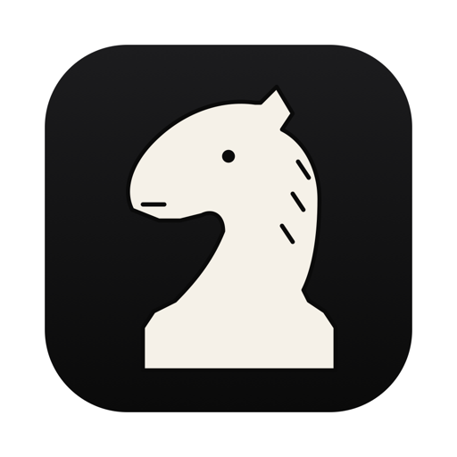
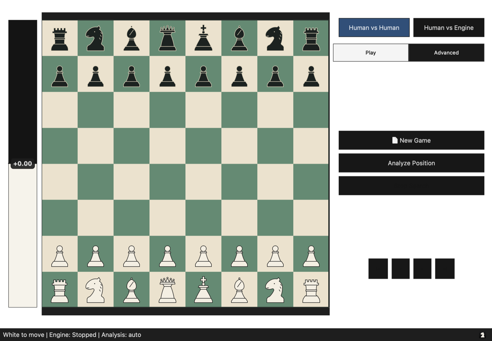
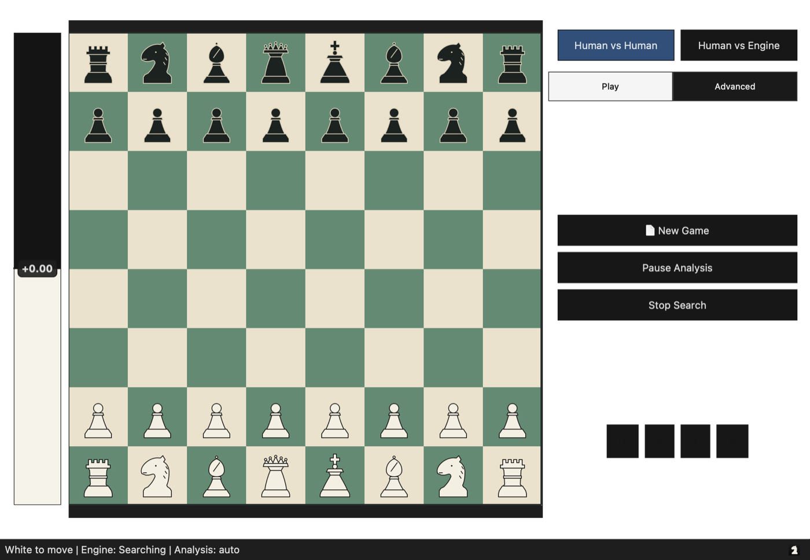
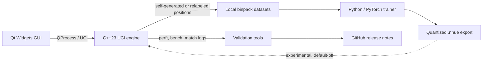

# LocalChessEngine

## Table Of Contents

- [Project Snapshot](#project-snapshot)
- [Screenshots](#screenshots)
- [Architecture](#architecture)
- [Engine](#engine)
- [Desktop GUI](#desktop-gui)
- [NNUE And Trainer](#nnue-and-trainer)
- [Validation Evidence](#validation-evidence)
- [Quick Start](#quick-start)
- [Repository Map](#repository-map)
- [Release And Compliance](#release-and-compliance)
- [Portfolio Notes](#portfolio-notes)

## Project Snapshot

LocalChessEngine is a local-first chess project built from scratch: a C++23 UCI engine, a Qt
Widgets desktop GUI for macOS, a Python/PyTorch NNUE trainer, and the validation tooling needed to
measure correctness, stability, packaging, and strength regressions.

| Area | Current v0.2 baseline |
| --- | --- |
| Engine | C++23 bitboard engine with legal move generation, FEN, Zobrist, make/unmake, perft, UCI, HCE, search, TT, move ordering, time management, Lazy SMP, and bench |
| GUI | Qt 6.10.3 Widgets/Svg app bundle, native macOS menus, legal board interaction, PGN load/save/navigation, preferences, play-vs-engine, continuous analysis, PV/log panels, and evaluation bar |
| Trainer | Python 3.11+ PyTorch package with MPS/CPU device selection, pybind11 binpack loader, `small` and `v1` NNUE architectures, JSONL metrics, checkpoints, quantized `.nnue` export, and C++ scalar/NEON runtime checks |
| Release state | v0.2 is an HCE-default portfolio polish release. NNUE is technically integrated but not promoted for strength because `BLK-002` remains active |
| Platform | macOS on Apple Silicon; CMake presets and vcpkg manifest mode |
| Validation | doctest/CTest, exact perft, sanitizers, clang-format/clang-tidy, bounded parser fuzzing, Cute Chess smoke, OpenBench templates, PGO/performance workflow, compliance/package checks |
| License model | Project-owned code/assets under MIT; Qt dynamically linked under LGPLv3 for the GUI |

## Screenshots

<p align="center">
  
</p>

<p align="center">
  
  
</p>

The screenshots are generated by the app itself with smoke flags, then versioned under
`docs/assets/readme/` so the README does not depend on local `build/` output.

## Architecture



The core boundary is intentional: the engine remains a standalone UCI process and does not depend on
Qt, PyTorch, or GUI code. The GUI can use stable engine-core rules for local legal interaction, but
engine play and analysis go through UCI.

## Engine

The engine is the main correctness and performance surface of the project.

- Board model: 12 piece bitboards, color occupancies, combined occupancy, 64-square mailbox,
  deterministic Zobrist key, and compact 16-bit `Move`.
- Move generation: staged pseudo-legal generation, check-evasion support, strict legality through
  `make_move`, exact make/unmake restoration, standard FIDE chess only.
- Sliding attacks: deterministic fancy magic bitboards for Apple Silicon; no PEXT/BMI2 dependency.
- Rules and formats: FEN parse/serialize, castling, en passant, promotion, check, mate, stalemate,
  fifty-move helper, external repetition helper, and practical insufficient-material detection.
- Search: alpha-beta/negamax, quiescence, iterative deepening, PVS, aspiration windows, TT,
  MovePicker, MVV-LVA, killers, history, continuation history, SEE, time management, and Lazy SMP.
- Experimental search toggles: pruning/reduction/extension features are exposed but remain
  default-off unless backed by match evidence.
- Evaluation: HCE remains the default and fallback. It includes material, PSQT, tapered scoring,
  mobility, pawn structure, bishop pair, rook-file terms, and king-safety terms.
- Tooling: `bench`, perft/divide CLI, Texel helper, NNUE data generator, NNUE bench, and
  OpenBench-compatible templates.

Accepted bench signature for the release baseline: `18417` nodes. NPS varies by machine and load.

## Desktop GUI

The desktop application is a Qt Widgets/Svg macOS app bundle. It is deliberately minimal and
engine-centric rather than a marketing shell.

- Custom `BoardWidget` draws the board and SVG pieces with cached pixmaps.
- Supports click-click and drag move gestures, board orientation, selected-square highlights,
  legal-move hints, last-move highlighting, promotion flow, and check state.
- The current evaluation is shown in a board-adjacent vertical `EvaluationBarWidget`.
- The simple Play sidebar focuses on game mode, state, actions, analysis depth/PV, and move
  navigation.
- The Advanced tab keeps diagnostic engine state, nodes, NPS, hashfull, graph, PV, and compact UCI
  event log.
- `EngineController` owns the `QProcess` UCI lifecycle: start, stop, restart, readiness, search
  commands, `info` parsing, `bestmove`, crash handling, and options.
- Preferences persist engine path, Hash, Threads, MultiPV, Move Overhead, NNUE experimental options,
  move time, and analysis behavior with validation before applying.
- PGN support is intentionally scoped to one mainline game: load, navigate, save, and Save As.
  Comments/NAGs are ignored and variations are skipped with warning rather than preserved.

## NNUE And Trainer

The NNUE pipeline exists and is valuable engineering work, but it is not a promoted strength path in
v0.2. HCE is the default release evaluation.

| Network / run | What passed | Match result |
| --- | --- | --- |
| Smoke dataset and loader | Local binpack format, manifest/checksum validation, pybind11 streaming loader, PyTorch tensor conversion | Format evidence only |
| `small` `(768->512)x2->1` CReLU | Training, v2 export, Python/C++ quantized equivalence, scalar/NEON checksum equality, corrected opening gate | Failed the `+50 Elo` gate; Stage B was roughly equal at `25-24-31`, `+4.3 +/- 60.1 Elo`, SPRT `[0,50]` inconclusive |
| `v1` `(768->1024)x2->1` SCReLU | MPS training, checkpoint/export, quantization, C++ load, scalar/NEON runtime equivalence | Not promoted; corrected 80-game probe was `22-23-35`, score `0.494`, `-4.3 +/- 57.5 Elo` |

`BLK-002` remains active: the current own-label data/objective does not produce a network that
beats HCE. External Stockfish/Lichess labels were used only diagnostically; the compliant path uses
Lichess/Hugging Face rows as FEN diversity and relabels positions locally with LocalChessEngine.

The compact public release notes summarize the NNUE evidence that matters for
portfolio review: the pipeline is real, the runtime path is validated, and no
network is promoted without strength evidence.

## Validation Evidence

The GitHub release notes are the best public source for the current state:

- [v0.2.0 release notes](https://github.com/jnjambrin0/Master-Chess/releases/tag/v0.2.0)

Key release-gate results from that report:

| Gate | Result |
| --- | --- |
| Perft correctness | PASS: six CPW positions matched depth-4 references |
| UCI/Cute Chess playability | PASS: 2-game smoke, no illegal moves, crashes, disconnects, timeouts, forfeits, or missing output |
| HCE baseline | PASS: HCE remains default and fallback |
| NNUE pipeline | PASS as pipeline/equivalence evidence; not promoted for strength |
| GUI baseline | PASS: GUI controller tests and smoke snapshots passed |
| Compliance package | PASS: LGPL/legal/source package check passed |
| Release package | PARTIAL: Developer ID signed DMG was generated and mounted successfully; Apple notarization was blocked by network access, so Gatekeeper still reports `Unnotarized Developer ID` |
| Archived deep gates | v0.1 remains the accepted sanitizer/lint/fuzz/package baseline; v0.2 did not change engine/search defaults |

Broader public documentation:

- `docs/compliance/release-checklist.md`
- `docs/compliance/privacy.md`
- `docs/compliance/qt-relink.md`

## Quick Start

From the repository root:

```sh
export VCPKG_ROOT="$PWD/.deps/vcpkg"
export PATH="$VCPKG_ROOT:/opt/homebrew/opt/llvm/bin:$PATH"
source .venv/bin/activate
python3 -m pip install -e trainer
```

Build the engine and GUI:

```sh
cmake --preset debug
cmake --build --preset debug --target localchessengine localchessengine_gui
```

Run the engine:

```sh
./build/debug/engine/localchessengine
./build/debug/engine/localchessengine bench
```

Run the GUI smoke:

```sh
./build/debug/gui/localchessengine_gui.app/Contents/MacOS/localchessengine_gui --smoke-exit
```

Run the standard validation suite:

```sh
ctest --preset debug --output-on-failure
```

Run the full local quality gate when changing core behavior:

```sh
bash tools/validate-quality.sh
```

## Repository Map

| Path | Purpose |
| --- | --- |
| `engine/` | C++23 engine core, public engine APIs, UCI executable, HCE/NNUE runtime, engine data fixtures |
| `gui/` | Qt Widgets/Svg desktop app, board rendering, preferences, PGN UI, UCI process control |
| `trainer/` | Python/PyTorch NNUE package, pybind11 binpack loader, training, serialization, tests |
| `tests/` | doctest/CTest coverage for engine, parser, search, NNUE, PGN, and GUI controller behavior |
| `tools/` | validation scripts, perft/bench tools, fuzz harnesses, performance/PGO workflow, match tooling, release/compliance utilities |
| `docs/assets/readme/` | versioned README icon and GUI screenshots |
| `docs/compliance/` | privacy, Qt relink, and release compliance docs |

Generated output is local and untracked: `build/`, `.deps/`, `.venv/`, `CMakeUserPresets.json`,
large datasets, checkpoints, logs, traces, and package outputs.

## Release And Compliance

Project-owned source, documentation, and self-authored chess-piece/app assets are MIT licensed. The
GUI links Qt Core/Gui/Widgets/Svg/SvgWidgets dynamically under LGPLv3 for v0.2; the engine remains a
separate non-Qt UCI executable.

Release packages are expected to include:

- `NOTICE`
- `THIRD_PARTY_NOTICES.md`
- `LICENSE`
- `COPYING.LGPL-3.0.txt`
- `COPYING.GPL-3.0.txt`
- Qt relink instructions
- compliance source archive

Compliance docs:

- `docs/compliance/privacy.md`
- `docs/compliance/qt-relink.md`
- `docs/compliance/release-checklist.md`

## Portfolio Notes

This project is intended to demonstrate more than a playable chess UI:

- correctness-first engine development with exact perft and make/unmake invariants,
- measurable search engineering rather than unverified heuristic stacking,
- clean process isolation between desktop UI and engine,
- local-first ML infrastructure with reproducible manifests and checksums,
- honest promotion policy for NNUE and search changes,
- macOS packaging discipline, dynamic Qt compliance, and release evidence.

The most important design choice is the same across the codebase: keep the implementation simple
where possible, but make every serious claim testable.
